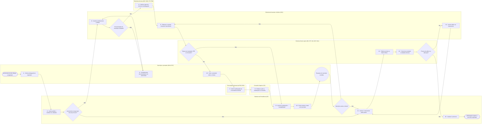
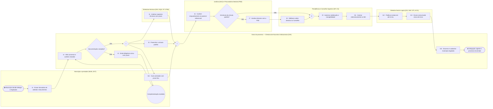

# BPMN AS-IS e TO-BE — celebração de convênio ou contrato de delegação da regulação

Arquivos BPMN 2.0: `saida/bpmn/CONV.bpmn` (AS-IS) e `saida/bpmn/CONV-TOBE.bpmn` (TO-BE), que abrem no Camunda Modeler, bpmn.io e Bizagi. O visualizador com os dois diagramas está em `docs/bpmn/index.html`. Os modelos canônicos ficam em `saida/bpmn/modelo_CONV.json` e `modelo_CONV-TOBE.json`.

## Como os modelos foram feitos

1. **Fichas por peça** (`dados/fichas/*.jsonl`, consolidadas em `saida/fichas_trabalho.jsonl`): cada uma das 321 peças dos 14 processos recebeu atividade, unidade, data e evidência literal. As evidências foram ancoradas por código no texto da peça.
2. **Vínculo atividade → tarefa** (`scripts/pipeline_agergs.py`, `ATIV_TAREFA`): encaminhamentos puros não viram tarefa e contam como passagem. A oitiva do prestador antes da assinatura vira t16; depois dela, t13.
3. **Modelo canônico**: consolida os 18 casos num fluxo de até 25 elementos. Variações observadas viram decisões com laço. Nenhum número vai no modelo: os números saem de `saida/fase2/procedimento_CONV.json`.
4. **Gerador**: o próprio `metodologia-repo/scripts/gerar_bpmn.py` (perfil `rs_agergs`), chamado por `scripts/gerar_bpmn_agergs.py`. A espera mediana ≥ 20 du aparece em vermelho; o sinal de perda em metade ou mais dos casos, em âmbar.

**Situação do código:** indicativo. São 18 casos, mas a auditoria às cegas dos rótulos ficou abaixo de 85% nas peças substantivas (ver `saida/auditoria/auditoria_classificador_CONV.json`). Os números são indicativos: com 18 casos, ainda pouco acima de 15, a mediana segue sensível a cada caso novo.

**Limite declarado:** os PDFs exportados do SEI não trazem andamentos. A trilha foi reconstruída pela data de assinatura de cada peça, ou pela data escrita no texto nas peças externas. O tempo em fila dentro de cada unidade não é observável diretamente.

## AS-IS — Celebração de convênio ou contrato de delegação da regulação (AS-IS)

Escopo: Do pedido do município para delegar a regulação à AGERGS até a assinatura, publicação, comunicação ao prestador e arquivamento do processo.

### Tarefas (números da coorte)

| Tarefa | Raia | Gatilho | Saída | Casos (%) | Ocorrências | Laço (casos) | Espera antes mediana (du) | Horas piso–teto mediana (h) |
|---|---|---|---|---|---|---|---|---|
| t1 · Solicitar delegação da regulação | Município e prestador (MUN, EXT) | Interesse do município ou tratativa prévia com a AGERGS | Ofício do prefeito pedindo convênio ou contrato de regulação | 12 (66,7%) | 13 | 1 | 0 | 0–0 |
| t2 · Autuar pedido e distribuir às unidades | Gabinete da Presidência (GP) | Ofício do município ou instrumento recebido | Processo SEI aberto e memorando de distribuição | 8 (44,4%) | 9 | 1 | 1 | 0,1–0,4 |
| t6 · Analisar juridicamente o pedido | Diretoria de Assuntos Jurídicos (DAJ) | Processo distribuído com pedido e documentos do município | Informação jurídica sobre requisitos, lei autorizativa e minuta | 11 (61,1%) | 20 | 8 | 3,5 | 1,1–2,3 |
| t3 · Complementar documentação e lei autorizativa | Município e prestador (MUN, EXT) | Pedido de complementação da AGERGS | Lei municipal autorizativa, contrato com o prestador, PMSB e dados | 15 (83,3%) | 25 | 7 | 0 | 0–0 |
| t4 · Analisar aspectos técnicos da delegação | Diretorias técnicas (DSI, DQS, DT, DTM) | Consulta da DG ou do Gabinete sobre o serviço e o prestador | Memorando técnico sobre o serviço, o prestador e a viabilidade | 2 (11,1%) | 2 | 0 | 1 | 1,3–2,5 |
| t5 · Elaborar ou ajustar minuta do instrumento | Diretoria de Assuntos Jurídicos (DAJ) | Análise jurídica favorável ou pedido de ajuste do município | Minuta de convênio ou contrato de regulação | 12 (66,7%) | 19 | 5 | 0 | 1,4–1,9 |
| t16 · Ouvir o prestador sobre a minuta | Município e prestador (MUN, EXT) | Minuta ou pedido enviado à CORSAN antes da assinatura | Carta ou manifestação do prestador sobre a minuta | 3 (16,7%) | 17 | 2 | 1 | 0,3–0,6 |
| t7 · Emitir manifestação da Procuradoria Setorial | Procuradoria Setorial da PGE (PSE) | Minuta e informação jurídica encaminhadas à PSE | Informação ou acolhimento da PSE | 2 (11,1%) | 2 | 0 | 0 | 1–1,3 |
| t8 · Deliberar sobre a celebração no Conselho | Conselho Superior (CS) | Processo distribuído ao Conselho Superior | Voto do relator, ata e resolução decisória | 3 (16,7%) | 6 | 2 | 0,5 | 1,8–4,2 |
| t9 · Autorizar celebração e inexigibilidade | Gabinete da Presidência (GP) | Minuta aprovada pelas instâncias internas | Despacho ou memorando de autorização da Presidência ou DG | 1 (5,6%) | 1 | 0 | 0 | 1,1–1,7 |
| t10 · Enviar minuta e tratar com município | Gabinete da Presidência (GP) | Minuta aprovada ou diligência pendente | Ofício ou e-mail ao município com a minuta ou o pedido | 10 (55,6%) | 29 | 4 | 0 | 0,4–0,6 |
| t11 · Assinar o instrumento pelas partes | Gabinete da Presidência (GP) | Minuta final aceita pelo município | Convênio ou contrato assinado pelo prefeito e pela Presidência | 12 (66,7%) | 13 | 1 | 0 | 0,7–0,9 |
| t12 · Publicar extrato no Diário Oficial | Diretoria-Geral e apoio (DG, DTI, DAI, DAF, DAU) | Instrumento assinado juntado ao processo | Extrato ou súmula publicada no DOE | 12 (66,7%) | 15 | 2 | 2 | 0,3–0,5 |
| t13 · Comunicar prestador e unidades internas | Diretoria-Geral e apoio (DG, DTI, DAI, DAF, DAU) | Instrumento assinado ou publicado | Comunicados à CORSAN, às diretorias e cadastro interno | 9 (50%) | 23 | 4 | 3 | 0,3–0,6 |
| t14 · Instruir aditivo ao instrumento | Diretoria de Assuntos Jurídicos (DAJ) | Pedido de alteração do objeto, prazo ou competências | Minuta ou termo aditivo | 2 (11,1%) | 2 | 0 | 0,5 | 0,3–0,8 |
| t15 · Arquivar o processo | Gabinete da Presidência (GP) | Providências pós-assinatura concluídas | Termo de arquivamento ou encerramento | 2 (11,1%) | 2 | 0 | 21,5 | 0,6–1 |

Horas são estimativa por peça: hipótese até a calibração com os servidores.

### Decisões

- **Instrumento já negociado fora do processo?** (g0): Não → Analisar juridicamente o pedido (t6); Sim → Assinar o instrumento pelas partes (t11)
- **Documentação do município completa?** (g1): Sim → Analisar aspectos técnicos da delegação (t4); Não → Complementar documentação e lei autorizativa (t3)
- **Exige ouvir prestador, PSE ou Conselho?** (g2): Não → Autorizar celebração e inexigibilidade (t9); Sim → Ouvir o prestador sobre a minuta (t16)
- **Município aceita a minuta?** (g3): Sim → Assinar o instrumento pelas partes (t11); Não → Elaborar ou ajustar minuta do instrumento (t5)
- **Precisa de aditivo ou alteração?** (g4): Não → Arquivar o processo (t15); Sim → Instruir aditivo ao instrumento (t14)

### Laços (retornos a etapa anterior)

- t3 → t6
- g3 → t5
- t14 → t11

### Transições mais frequentes na coorte

| De | Para | Passagens | % das saídas da origem |
|---|---|---|---|
| t10 | t3 | 9 | 31% |
| t6 | t5 | 9 | 45% |
| t5 | t6 | 7 | 36,8% |
| t10 | t16 | 5 | 17,2% |
| t11 | t13 | 5 | 45,5% |
| t13 | t16 | 5 | 25% |
| t16 | t10 | 5 | 29,4% |
| t5 | t10 | 5 | 26,3% |
| t1 | t2 | 4 | 30,8% |
| t1 | t3 | 4 | 30,8% |
| t10 | t13 | 4 | 13,8% |
| t12 | t13 | 4 | 36,4% |

Caminhos distintos: 18 em 18 casos. Nenhum caminho se repete.

Fontes do modelo: Consolidado das fichas e narrativas dos 12 processos de celebração (2018–2026) e do processo orientativo SEI 002594-39.00/26-9; variações observadas viram decisões com laço.

## TO-BE — Celebração de convênio ou contrato de delegação da regulação (TO-BE)

Escopo: Do formulário de adesão do município ao encerramento do processo, com dono único (DAI), kit de adesão, minuta padrão com parecer referencial, assinatura eletrônica e prazos por etapa.

### Tarefas

| Tarefa | Raia | Gatilho | Saída |
|---|---|---|---|
| t1 · Enviar formulário de adesão e documentos | Município e prestador (MUN, EXT) | Interesse do município | Formulário de adesão com documentação mínima |
| t2 · Abrir processo e conferir checklist | Dono do processo — Diretoria de Assuntos Institucionais (DAI) | Formulário de adesão recebido | Processo SEI do tipo próprio e checklist conferido |
| t3 · Emitir diligência única com prazo | Dono do processo — Diretoria de Assuntos Institucionais (DAI) | Pendência no checklist | Ofício único com todas as pendências e prazo |
| t4 · Analisar aspectos técnicos com prazo | Diretorias técnicas (DSI, DQS, DT, DTM) | Checklist completo | Memorando técnico sobre serviço e prestador |
| t5 · Preencher a minuta padrão | Dono do processo — Diretoria de Assuntos Institucionais (DAI) | Checklist completo | Minuta padrão preenchida e quadro de desvios |
| t16 · Ouvir prestador com prazo fixo | Município e prestador (MUN, EXT) | Minuta padrão preenchida enviada ao prestador | Manifestação do prestador ou prazo decorrido |
| t6 · Conferir enquadramento no parecer referencial | Jurídico (DAJ) e Procuradoria Setorial (PSE) | Minuta, análise técnica e manifestação do prestador | Atestado de enquadramento ou apontamento de desvio |
| t7 · Analisar desvios com a PSE | Jurídico (DAJ) e Procuradoria Setorial (PSE) | Desvio apontado | Informação jurídica e manifestação da PSE sobre os desvios |
| t8 · Deliberar sobre desvios no Conselho | Presidência e Conselho Superior (GP, CS) | Desvio relevante, conforme critério do rito | Resolução do Conselho Superior |
| t9 · Autorizar celebração e inexigibilidade | Presidência e Conselho Superior (GP, CS) | Enquadramento atestado ou desvio aprovado | Autorização e justificativa de inexigibilidade nos autos |
| t11 · Assinar eletronicamente no SEI | Presidência e Conselho Superior (GP, CS) | Autorização; prefeito liberado como usuário externo | Instrumento assinado pelas partes no SEI |
| t12 · Publicar extrato em até 10 du | Diretoria-Geral e apoio (DG, DAF, DTI, ACS) | Última assinatura | Extrato publicado e juntado |
| t13 · Enviar comunicado único de início | Diretoria-Geral e apoio (DG, DAF, DTI, ACS) | Extrato publicado | Comunicado ao prestador, DAF, diretorias, DTI e DAU |
| t15 · Encerrar e cadastrar município regulado | Dono do processo — Diretoria de Assuntos Institucionais (DAI) | Comunicado enviado | Termo de encerramento e cadastro atualizado |

### Decisões

- **Documentação completa?** (g1): Sim → p1 (p1); Não → Emitir diligência única com prazo (t3)
- **Há desvio da minuta padrão?** (g2): Não → g3 (g3); Sim → Analisar desvios com a PSE (t7)

### O que muda em relação ao AS-IS

- Dono único do processo (DAI), do formulário ao encerramento (M-CONV-04).
- Kit de adesão e diligência única no lugar de rodadas de complementação (M-CONV-01, M-CONV-10).
- Análise técnica, minuta padrão e oitiva do prestador correm em paralelo, com prazo (M-CONV-02, M-CONV-04).
- Parecer referencial: o jurídico confere o enquadramento, e a PSE e o Conselho só entram nos desvios (M-CONV-02, M-CONV-03).
- Autorização e inexigibilidade no próprio processo, assinatura eletrônica no SEI (M-CONV-09), extrato em até 10 du da assinatura (M-CONV-05), comunicado único e encerramento (M-CONV-06).

Fontes do modelo: TO-BE: melhorias M-CONV-01 a M-CONV-12 (saida/fase3/melhorias_CONV.json), etapas do processo orientativo SEI 002594-39.00/26-9 e documentação mínima e minuta padrão do SEI 002840-39.00/26-3. A atribuição da DAI como dono do processo é proposta do processo orientativo, a validar.
